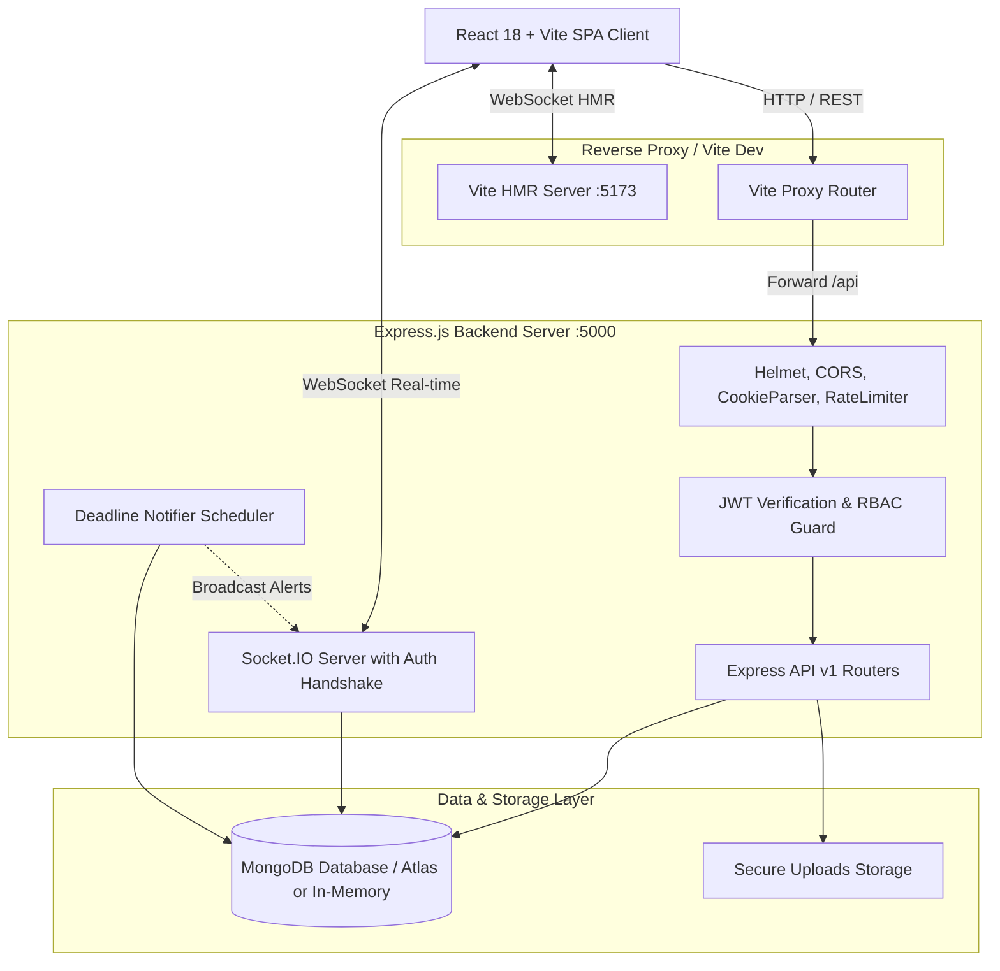
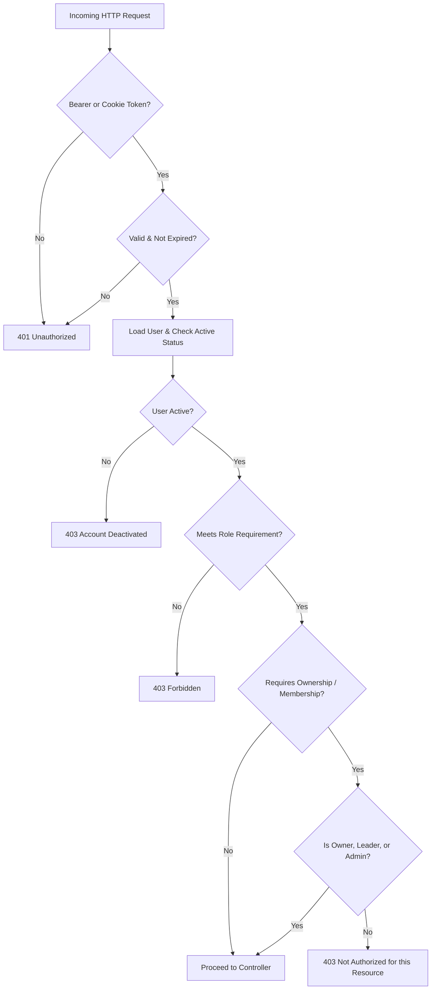

# 🏛️ STMS Architecture & System Design

This document details the architectural design, database modeling, access control patterns, and real-time communication infrastructure of the Student Task Management System.

---

## 1. High-Level System Architecture

---

## 2. Database Schema & Data Models

STMS utilizes MongoDB with Mongoose ODM. Schemas are indexed for high-volume academic querying:

### A. User Model (`User.js`)
- **Fields**: `name`, `email` (unique index), `passwordHash` (bcrypt with salt factor 12), `role` (`student`, `team_leader`, `admin`), `department`, `course`, `semester`, `avatarUrl`, `isActive`, `notificationPreferences`.
- **Hooks**: Automatic `bcrypt` hashing on pre-save if modified; `comparePassword` instance method; `toJSON` transformer automatically stripping `passwordHash`.

### B. Task Model (`Task.js`)
- **Fields**: `title`, `description`, `type` (`personal`, `team`, `academic`), `status` (`To Do`, `In Progress`, `In Review`, `Completed`), `priority` (`Low`, `Medium`, `High`, `Urgent`), `dueDate`, `startDate`, `estimatedHours`, `actualHours`, `creator` (ref User), `team` (ref Team, optional), `assignees` ([ref User]), `subtasks` ([{ title, completed }]), `attachments` ([{ name, path, mimeType, size, uploader }]).
- **Compound Indexes**:
  - `{ creator: 1, status: 1 }`
  - `{ team: 1, status: 1 }`
  - `{ assignees: 1, dueDate: 1 }`
  - Text search index on `{ title: 'text', description: 'text' }`

### C. Team Model (`Team.js`)
- **Fields**: `name`, `description`, `course`, `semester`, `leader` (ref User), `members` ([{ user: ref User, role: 'member'|'lead', joinedAt }]), `isActive`.
- **Indexes**: `{ leader: 1 }`, `{ 'members.user': 1 }`.

### D. Invitation Model (`Invitation.js`)
- **Fields**: `team` (ref Team), `invitedUser` (ref User), `invitedEmail`, `invitedBy` (ref User), `status` (`pending`, `accepted`, `rejected`, `expired`), `expiresAt`.

### E. Comment Model (`Comment.js`)
- **Fields**: `task` (ref Task, indexed), `author` (ref User), `content`, `createdAt`, `updatedAt`.

### F. Notification Model (`Notification.js`)
- **Fields**: `recipient` (ref User, indexed), `title`, `message`, `type` (`task_assigned`, `deadline_reminder`, `team_invitation`, `comment_added`, `status_changed`), `referenceId`, `referenceModel`, `isRead` (indexed with recipient).

### G. Activity Log Model (`ActivityLog.js`)
- **Fields**: `task` (ref Task, indexed), `user` (ref User), `action` (`created`, `updated_status`, `assigned_user`, `added_comment`, `uploaded_file`), `details`, `timestamp`.

### H. Password Reset Token (`PasswordResetToken.js`)
- **Fields**: `user` (ref User), `tokenHash`, `expiresAt` (Indexed with MongoDB **TTL expiration** `expireAfterSeconds: 0` for automatic garbage collection).

---

## 3. Role-Based Access Control (RBAC)

STMS enforces **deny-by-default** access control:

### Role Matrix:
| Feature | Student | Team Leader | Admin |
|---|:---:|:---:|:---:|
| View & Manage Personal Tasks | ✅ | ✅ | ✅ |
| Create Team Projects | ❌ | ✅ | ✅ |
| Invite Students to Team | ❌ | ✅ | ✅ |
| Assign Tasks to Team Members | ❌ | ✅ | ✅ |
| Accept / Reject Team Invites | ✅ | ✅ | ✅ |
| Update Assigned Task Status | ✅ | ✅ | ✅ |
| Delete Team Tasks | ❌ (Unless Creator) | ✅ | ✅ |
| View System Telemetry | ❌ | ❌ | ✅ |
| Modify User Roles & Status | ❌ | ❌ | ✅ |

---

## 4. Real-Time WebSocket Infrastructure (Socket.IO)

1. **Authentication Handshake**:
   - The Socket.IO connection verifies the user's JWT from either the handshake query token or the HttpOnly authentication cookie.
   - Unauthenticated connections are rejected at the gateway.

2. **Room Architecture**:
   - `user:${userId}`: Personal alerts, invitations, task assignments, deadline reminders.
   - `task:${taskId}`: Collaborative task viewing; broadcasts comments, status moves, and uploads.
   - `team:${teamId}`: Team roster updates, member joins, and team-wide task creation.

3. **Client Query Invalidation**:
   - When a WebSocket event arrives, the React frontend automatically triggers TanStack Query cache invalidations, providing instant reactive UI updates without page reloads.

---

## 5. Security & Threat Mitigation

1. **Path Traversal Protection**:
   - All attachment filenames are replaced with cryptographic UUIDs and stored in a designated directory outside the public web server directory.
   - The download controller resolves absolute paths and verifies that the file resides strictly within the configured storage directory before streaming.

2. **Rate Limiting**:
   - General API limiter: 500 requests per 15 minutes.
   - Authentication limiter: 15 login/registration attempts per 15 minutes to thwart brute-force password cracking.

3. **Sensitive Field Protection**:
   - Mongoose schemas prevent password hashes or reset tokens from ever being returned in JSON responses.
